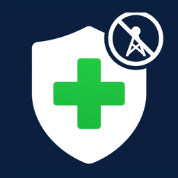
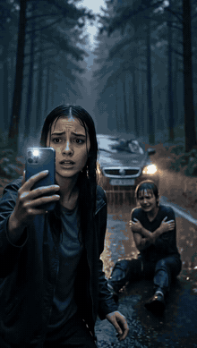
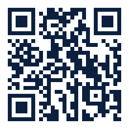
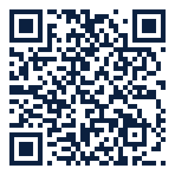

# No Signal Safe Kit

**Emergency and first aid help that works with no signal, no internet and no power grid.**

Free. No ads. No tracking. No account.

<b>📱 Available now for Android. 🍎 iOS coming soon.</b>

Android phones (64-bit). Latest version: see <a href="https://github.com/300SpartanDev/no-signal-safe-kit/releases/latest">Releases</a>.

  

&nbsp;&nbsp;

Watch in full quality: <a href="assets/safekit-promo.mp4">No signal promo</a> · <a href="assets/safekit-blackout.mp4">Blackout promo</a>

---

## 📴 Works 100% offline

Everything lives on your phone. Once installed, No Signal Safe Kit works in a forest with no bars, during a blackout, in airplane mode or when the network is down. Nothing is sent anywhere, ever.

## 🧠 Optional on-device AI assistant

Ask a question in your own words, like *"someone is choking"* or *"how do I treat a burn"*, and the **Ask** assistant answers right on your phone, with no internet. It only answers from the app's own guides and shows which guide each answer comes from.

> **Important:** the AI model is **not** inside the APK, to keep the download small.
> After installing, open **Settings** and download the AI model (about 1.1 GB) **while you still have Wi-Fi**. After that, the assistant works fully offline.
> The app works perfectly without the AI too: all guides, search and emergency numbers are always available.

## ✨ What's inside

- **First aid guides** with clear step-by-step pictures: CPR, choking, bleeding, burns, stroke, heart attack, severe allergic reaction, seizures, the recovery position, drowning, poisoning, low blood sugar, carbon monoxide, electric shock, bites and more.
- **Emergency numbers for 112 countries**, with the right local number shown big and red for the country you pick, plus police and fire.
- **Preparedness checklists** to get your home and go-bag ready before something happens.
- **Fast offline search** across every guide.
- **Private by design**: no ads, no tracking, no account, no data leaves your phone.

## 📲 Install in 3 steps (Android)

> 🍎 **iPhone user?** The iOS version is coming soon. Star ⭐ this page to get notified when it lands.

1. On your Android phone, tap **[Download the APK](https://github.com/300SpartanDev/no-signal-safe-kit/releases/latest/download/NoSignalSafeKit.apk)**.
2. Open the downloaded file. If Android asks, allow installs from this source (your browser or Files app), then tap **Install**.
3. Open the app, go to **Settings**, pick your country, and download the AI model while you're on Wi-Fi.

Android shows a warning for any app installed outside the Play Store. That's normal. Updates install right over the old version and keep your settings.

## ❤️ Support the app

No Signal Safe Kit is free, and its life-saving features will always stay free. If it helps you, a tip keeps it growing.

<table>
<tr>
<td align="center"><b>Ko-fi</b>  <a href="https://ko-fi.com/leonidasofficial">ko-fi.com/leonidasofficial</a></td>
<td align="center"><b>Solana (SOL)</b>  <code>W7fajLuygCWooQCVoDPUrz6KaPaiSqJY95iqVM9X9gr</code></td>
</tr>
</table>

---

⚠️ No Signal Safe Kit gives general first aid guidance and does not replace professional medical care. In an emergency, always call your local emergency number first.

© 2026 300SpartanDev. All rights reserved. The app is free to download, use and share as the original APK from this page. The app, name, logo, videos and content may not be copied, modified or redistributed in any other form without permission.
